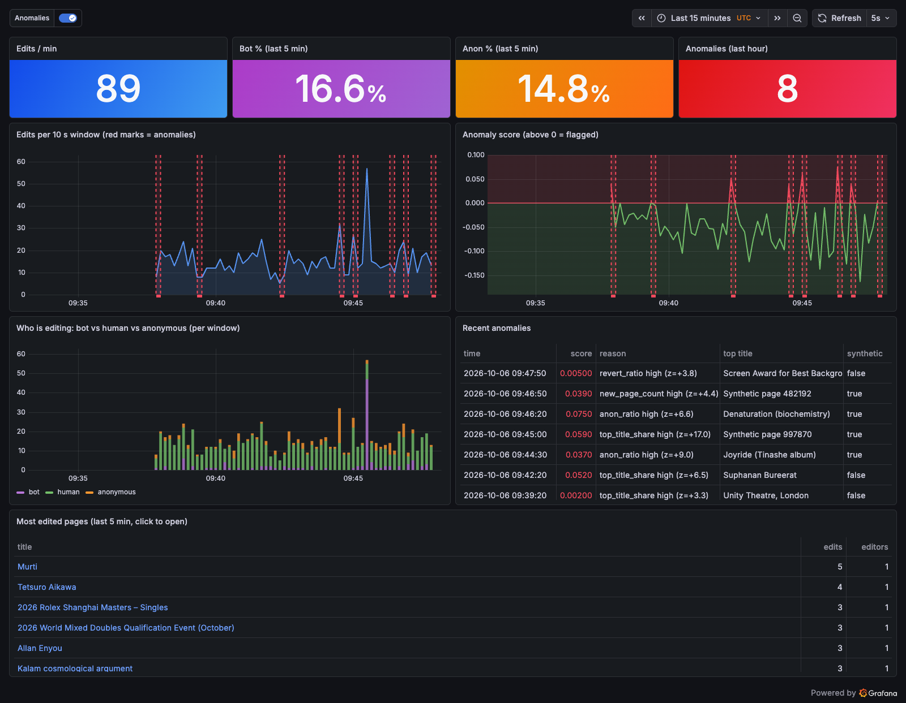

# WikiRadar

Real-time anomaly detection on live English Wikipedia edits.

Edits from the Wikimedia EventStreams `recentchange` feed go through Kafka, are aggregated into 10-second event-time windows, and each window is scored by an IsolationForest. Results are stored in Postgres and shown on a Grafana dashboard that refreshes itself every 5 seconds.

Course mini-project for 22CSE544 Data Streaming and Analysis. [PLAN.md](PLAN.md) is the build plan and [PROGRESS.md](PROGRESS.md) records each gate's checks.



## Architecture

```
Wikimedia EventStreams (SSE)          data/*.jsonl (recorded)
        |  producer.py --live                 |  producer.py --replay
        +-------------------+-----------------+
                            v
                 Kafka topic: wiki-edits (3 partitions, key = title)
                            ^
                            |  inject.py (synthetic attacks)
                            v
                 processor.py  (10 s windows -> features -> IsolationForest)
                            v
                       PostgreSQL
                            v
                 Grafana (5 s refresh)
```

| Layer | Choice |
|---|---|
| Data source | Wikimedia EventStreams, enwiki edits and new pages |
| Streaming | Apache Kafka 4.3 (KRaft, single node) |
| Processor | Python, event-time tumbling windows with a per-partition watermark |
| ML | scikit-learn IsolationForest, trained offline on 24 h of edits |
| Database | PostgreSQL 16 |
| Visualization | Grafana 12, provisioned from files |

## Prerequisites

- Docker (tested with OrbStack on an Apple Silicon Mac)
- [uv](https://docs.astral.sh/uv/) (it installs Python 3.12 for you)
- Internet access for `--live`; `--replay` works offline

## Start

```bash
cp .env.example .env                   # set WIKI_USER_AGENT to include your email, and POSTGRES_PASSWORD
uv sync
docker compose up -d                   # Kafka, Postgres, Grafana; wait until `docker compose ps` shows healthy
uv run scripts/processor.py            # terminal 1: start before the producer
uv run scripts/producer.py --live      # terminal 2 (offline: --replay data/sample_demo.jsonl --speed 1)
open http://localhost:3000/d/wiki-radar
```

No login is needed for the dashboard. Windows close about 15 seconds after they start (10 s window plus 5 s watermark), so the first points appear after about 20 seconds.

Trigger a synthetic anomaly (types: `vandal_wave`, `edit_war`, `bot_flood`, `page_blank`, `spam_pages`; intensity 1 to 5):

```bash
uv run scripts/inject.py --attack vandal_wave --intensity 3
```

Clean slate before a demo: stop the processor, then `uv run scripts/reset_db.py`.

Always replay at `--speed 1`. At higher speeds each window holds several times the normal number of edits, and the model flags almost every window.

## Demo script (5 minutes)

1. Reset the tables and open the empty dashboard. Explain the six layers from the architecture diagram (30 s).
2. Start the processor, then the producer (`--live`, or `--replay data/sample_demo.jsonl --speed 1` without network). The tiles count up and the curves draw themselves (60 s).
3. Explain one panel: bot vs. human vs. anonymous edits, and the most edited pages, whose links open the real Wikipedia pages (45 s).
4. Run `uv run scripts/inject.py --attack vandal_wave --intensity 3`. Within about 20 seconds a red annotation appears and the anomalies table shows `anon_ratio high`. Explain that training and live scoring share `wikiradar/features.py` (60 s).
5. Run `uv run scripts/inject.py --attack edit_war --intensity 4`. It is flagged with a different reason, `top_title_share high` (30 s).
6. Pause the producer with Ctrl-Z in its terminal: the page keeps refreshing but the numbers freeze. Resume with `fg` (30 s).
7. Close with the contamination sweep plot and detection numbers in `results/` (produced in Gate 6) (45 s).

## Troubleshooting

| Symptom | Fix |
|---|---|
| Producer exits with `403` or `429` | Set `WIKI_USER_AGENT` in `.env` to something like `WikiRadar-DSA-MiniProject/1.0 (you@example.com)`. The producer stops after two refusals in a row instead of retrying. Without network, use `--replay data/sample_demo.jsonl --speed 1`. |
| `Connection refused` for `localhost:9092`, or the processor exits with a Kafka timeout at startup | Kafka is not up yet. Run `docker compose ps` and wait for `kafka` to be healthy and `kafka-init` to have exited (0), which creates the `wiki-edits` topic. |
| Dashboard is empty | Check that the processor is running and was started before the producer (a new consumer group starts at the latest offset). Check the time range (last 30 min). `docker compose exec postgres sh -c 'psql -U "$POSTGRES_USER" -d "$POSTGRES_DB" -c "SELECT count(*) FROM window_metrics"'` should grow by 6 per minute. |
| Tiles stop changing | Expected when the producer is paused or the stream goes quiet: the newest window closes only when newer edits arrive. If the processor has been stopped for more than 30 min, the tiles go blank until it runs again. |
| Every window is flagged | Replay speed above 1, see above. |
| `FileNotFoundError: models/iforest.joblib` | Retrain, see below. |
| Postgres tables missing after editing `sql/schema.sql` | The schema runs only on an empty volume: `docker compose down -v && docker compose up -d`. |

## Retraining

`models/iforest.joblib` is committed. To retrain on fresh data (Wikimedia keeps about 7 days of history):

```bash
uv run scripts/producer.py --record data/train_24h.jsonl --since 2026-10-03T10:00:00Z --hours 24   # about 1 h
uv run scripts/train.py data/train_24h.jsonl                                                       # writes the model and models/model_card.json
```

## Tests

```bash
uv run pytest
```

## Repo layout

| Path | Purpose |
|---|---|
| `wikiradar/` | Shared library: config, SSE client, schema, windowing and features, model scoring, attacks, db |
| `scripts/` | Entry points: producer, processor, inject, train, reset_db (evaluate arrives in Gate 6) |
| `sql/` | Postgres schema |
| `grafana/` | Provisioned datasource and dashboard |
| `models/` | Trained model and model card |
| `data/` | Recorded edits (gitignored) and small committed samples |
| `results/` | Dashboard screenshot; evaluation outputs from Gate 6 |
| `report/` | Final report (Gate 7) |
| `tests/` | pytest suite |

## License

MIT, see [LICENSE](LICENSE).
