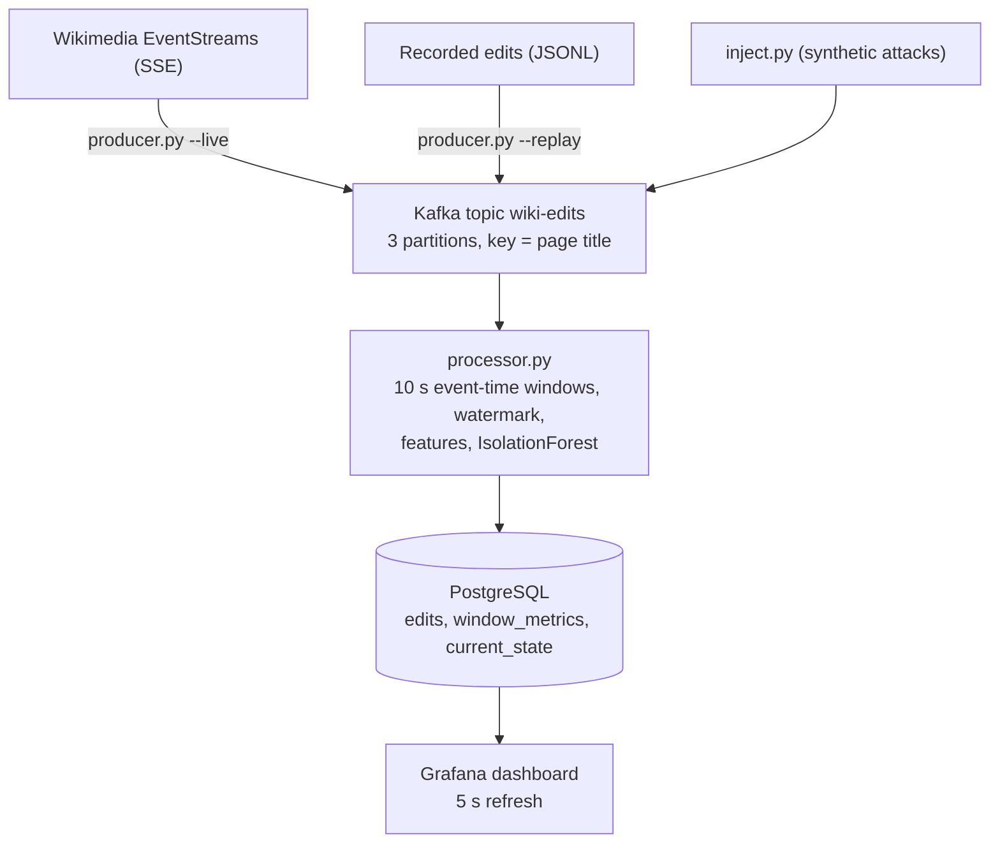
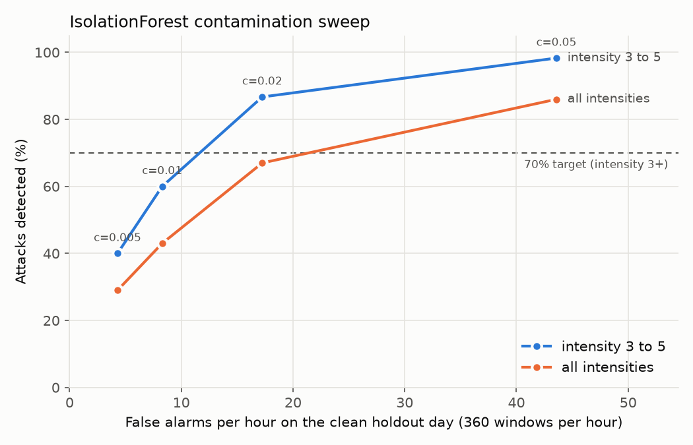

# WikiRadar: real-time anomaly detection on live Wikipedia edits

Course: 22CSE544 Data Streaming and Analysis, mini-project.

## Abstract

WikiRadar watches every edit to English Wikipedia as it happens and flags 10-second periods that look unusual, such as a wave of anonymous vandalism, an edit war, or a bot flooding the site. Edits arrive from the Wikimedia EventStreams feed, pass through Apache Kafka, and are grouped into 10-second windows by the time each edit was made, not the time it reached us. Each window becomes 11 numbers (how many edits, what share came from bots or anonymous users, how much text was removed, and so on), and an IsolationForest trained on one full day of real traffic scores it. Results go to PostgreSQL and a Grafana dashboard that refreshes itself every 5 seconds.

On a held-out day with 100 synthetic attacks mixed in, the system flags 87% of attacks at intensity 3 to 5 (80% when only windows that the attack itself pushed over the threshold are counted) at a cost of 17.3 false alarms per hour. Most of those false alarms cluster in five hours when the normal mix of bot and human traffic shifted. Live, an injected attack appears on the dashboard within 7 to 23 seconds, depending on where in its 10-second window it lands, and the pipeline ran for 2 hours unattended with flat memory and no lost or double-counted edits.

## 1. Architecture



| # | Layer | Choice | Why it exists |
|---|---|---|---|
| 1 | Data source | Wikimedia EventStreams `recentchange`, English Wikipedia only | A free, public, high-volume live stream (about 150 edits per minute) with real behaviour to model |
| 2 | Streaming | Apache Kafka 4.3 in KRaft mode, one broker | Decouples the network feed from processing: the processor can restart, fall behind or crash without losing edits, and the same topic accepts live, replayed and injected events |
| 3 | Stream processor | Python, event-time tumbling windows with a watermark | Turns an endless stream of single edits into fixed 10 s summaries the model can score |
| 4 | Machine learning | scikit-learn IsolationForest, trained offline | Finds unusual windows without labelled examples of attacks, which do not exist for this data |
| 5 | Database | PostgreSQL 16 | A serving layer between the processor and the dashboard: stores results durably and answers the dashboard's queries |
| 6 | Visualization | Grafana 12, provisioned from files | A dashboard that updates itself from a live data source, with no custom frontend |

Infrastructure (Kafka, Postgres, Grafana) runs in Docker; the Python services run on the host. The whole system starts with `docker compose up -d` and three commands (processor, producer, open Grafana), and there is an offline mode (`--replay`) for demos without network.

## 2. Dataset

The source is the `recentchange` stream, which carries every change on every Wikimedia wiki. The producer keeps only English Wikipedia (`wiki == "enwiki"`) edits and page creations (`type` is `edit` or `new`) and drops everything else: in a sample taken while building the producer, it kept 938 of 26,719 events (3.5%). One real event, with the username redacted:

```json
{
  "meta": { "id": "4b39663b-9d48-4376-afd0-9ce1385c4893", "dt": "2026-10-03T10:34:23.164Z" },
  "type": "edit",
  "namespace": 0,
  "title": "Birlenbach",
  "title_url": "https://en.wikipedia.org/wiki/Birlenbach",
  "comment": "/* Transport links */ typo",
  "user": "[redacted]",
  "bot": false,
  "minor": true,
  "length": { "old": 1971, "new": 1961 },
  "revision": { "old": 1377573905, "new": 1378187223 },
  "wiki": "enwiki"
}
```

The producer turns each event into a small `Edit` record: a unique event id, the event time `dt`, the title and link, the user, whether the user is a bot, whether the user is anonymous (an IP address or one of Wikipedia's temporary accounts, whose names start with `~`), whether it created a new page, the change in size in bytes (here -10), whether the comment says it is a revert, and the revision id. Events with missing fields are counted and dropped instead of crashing the producer.

Wikipedia's stream can replay roughly the last 7 days on request (`?since=`), so the training and test data were recorded in under an hour rather than waiting two days:

| File | Period (UTC) | Edits | 10 s windows |
|---|---|---|---|
| `train_24h.jsonl` | Oct 3 10:00 to Oct 4 10:00 | 226,343 | 8,640 |
| `holdout_24h.jsonl` | Oct 4 10:00 to Oct 5 10:00 | 216,653 | 8,640 |

Both files cover the full 24 hours with no duplicates and no gap longer than about 11 seconds. On average a window holds about 26 edits. Traffic follows a strong daily cycle: on the training day it ranged from 4,643 edits per hour (10:00 UTC) to 13,226 (20:00 UTC), and the share of edits made by bots ranged from 7% to 53% by hour. About 6% of edits come from anonymous users.

## 3. Layer by layer

### 3.1 Data source and producer

`scripts/producer.py` has three modes: `--live` streams from Wikimedia into Kafka, `--record` writes to a file (with `--since` for backfill), and `--replay` plays a file back into Kafka. The connection is a long-lived HTTP stream (Server-Sent Events). When it drops, which happened 11 times in a 2-hour run, the client reconnects and sends back the id of the last event it saw, so Wikimedia resumes exactly where it left off:

```python
headers = {"User-Agent": self.user_agent, "Accept": "text/event-stream"}
params = None
if self.last_id:
    headers["Last-Event-ID"] = self.last_id
elif self.since:
    params = {"since": self.since}
```

Wikimedia rejects clients without a descriptive User-Agent. If it refuses twice in a row (HTTP 403 or 429), the producer stops instead of retrying forever.

Replay re-stamps event times to the present (`new_dt = now + (orig_dt - first_dt) / speed`), so replayed and injected edits share one timeline. Replay must run at speed 1: at speed S, each 10 s window holds S times the normal number of edits, and at speed 20 the model, correctly, flagged most windows.

### 3.2 Streaming: Kafka

One Kafka broker in KRaft mode (no ZooKeeper) holds the topic `wiki-edits` with 3 partitions. Each message's key is the page title, so all edits to one page stay in order on one partition. The producer waits for the broker to confirm every write and uses Kafka's idempotent producer, so a network retry cannot write the same message twice:

```python
Producer({
    "bootstrap.servers": config.KAFKA_BOOTSTRAP,
    "acks": "all",
    "linger.ms": 20,
    "enable.idempotence": True,
})
```

Kafka is what lets the processor be stopped and restarted. Messages stay in the topic, and the processor's consumer group remembers how far it has read.

### 3.3 Stream processor: event time and the watermark

The processor groups edits into 10-second tumbling windows (12:00:00 to 12:00:10, 12:00:10 to 12:00:20, ...) by **event time**, the moment the edit was made on Wikipedia, not by **processing time**, the moment the processor happens to read it. The difference matters whenever reading is delayed: after a restart the processor reads several minutes of backlog in a few seconds, and with processing-time windows that backlog would collapse into one huge window. With event-time windows the backlog lands in the windows it belongs to, and replay at speed 20 still produced windows 10 seconds apart in event time.

Event time creates a new problem: the processor never knows for sure that a window is complete, because an older edit could still arrive. The **watermark** answers that. It is the latest event time seen minus 5 seconds (tracked per partition, as explained below); once a window's end is behind the watermark, the window is closed, scored and written. An edit that arrives later than that for an already-closed window is counted as late and not added. In normal running no edits were late.

The first version used one watermark for the whole stream. Testing a restart exposed a flaw: Kafka delivered one partition's backlog first, which pushed the watermark to the present, and the other two partitions' backlog was then dropped as late (43 edits, 4 windows undercounted). The fix, the same idea as Flink's per-partition watermarks, is a watermark per partition: the window closes only when the slowest partition has moved past it.

```python
def add(self, edit: Edit, source: int = 0) -> list[ClosedWindow]:
    start = window_start(edit.dt)
    if self.closed_until and start < self.closed_until:
        self.late_dropped += 1
        return []
    self.buckets.setdefault(start, []).append(edit)
    self.waiting.discard(source)
    self.source_max[source] = max(self.source_max.get(source, edit.dt), edit.dt)
    return self._advance()

def _advance(self) -> list[ClosedWindow]:
    if self.waiting or not self.source_max:
        return []
    return self._close_until(min(self.source_max.values()) - LATENESS)
```

A partition that receives nothing for 3 seconds while the others keep delivering stops holding the watermark back, so a quiet partition cannot freeze the dashboard. If the whole stream goes quiet, no window closes until edits arrive again, which is why the dashboard freezes when the producer is paused. Windows with no edits inside the observed range are still written with zero counts, because a sudden silence is information too.

`WindowAggregator` is a plain class with no input or output of its own. That is what lets training, live processing and evaluation all use the same code (section 3.4).

### 3.4 Machine learning: IsolationForest

Each closed window becomes 11 features, computed in `wikiradar/features.py`:

| Feature | Meaning |
|---|---|
| `edit_count` | log(1 + number of edits) |
| `bot_ratio`, `anon_ratio` | share of edits by bots, by anonymous users |
| `new_page_count` | log(1 + new pages) |
| `mean_abs_delta` | log(1 + average size of a change in bytes) |
| `min_delta` | the most negative size change (the smallest addition if nothing was removed), on a signed log scale |
| `revert_ratio` | share of edits whose comment says they undo another edit |
| `top_title_share` | share of edits that went to the single most edited page |
| `unique_users_ratio` | distinct users divided by edits |
| `hour_sin`, `hour_cos` | the UTC hour of the window as a point on a circle |

There are no labels saying which windows were attacks, so the model must be unsupervised. An IsolationForest builds 200 random trees that split the data on random features at random values; unusual points end up isolated after few splits, normal points after many. scikit-learn's `decision_function` is positive for normal points and negative for outliers; WikiRadar flips its sign so that a higher score means more unusual, and a score above 0 means flagged.

```python
model = IsolationForest(n_estimators=200, contamination=contamination, random_state=42).fit(X)
```

Each flagged window also gets a plain-language **reason**: the feature furthest from its training average, measured in standard deviations, for example `anon_ratio high (z=+8.6)`. The hour features are never used as a reason, because they describe when something happened, not what.

**Train/serve split and shared code.** The model is trained offline (`scripts/train.py`) on the recorded training day and scored live (`scripts/processor.py`). A common bug in such systems is training/serving skew: the live code computes a feature slightly differently from the training code, and the model quietly sees different inputs than it learned from. WikiRadar avoids this by construction: windowing and features exist in exactly one place, `wikiradar/features.py`, and training, the live processor and the evaluation all import it. The model file also stores the list of feature names it was trained on, and the processor refuses to start if they do not match the code.

**Contamination.** IsolationForest's `contamination` parameter sets what share of the training windows it treats as anomalous, and so where the threshold sits. It is a direct trade-off: a lower value raises fewer false alarms but misses weaker attacks, and a higher value catches more attacks at the cost of more false alarms (measured in section 4).

**Daily cycle and the hour features.** Wikipedia is busiest in the European and American evening and quietest in the hours after, and bot activity swings even more. Without knowing the hour, the model would see the quiet early morning as abnormally quiet every day. The hour is encoded as sine and cosine so that 23:00 and 00:00 are neighbours. The cost appears in section 4: with only one training day, the model learns one example of each hour, and when the holdout day's quiet, low-bot period arrived five hours earlier than on the training day, the model flagged it.

### 3.5 Database: PostgreSQL

Three tables serve the dashboard: `edits` (each edit, kept for 24 hours), `window_metrics` (each window's features, score, flag and reason) and `current_state` (one row with the numbers for the summary tiles).

Kafka guarantees **at-least-once** delivery: after a crash, messages since the last saved position are delivered again. The database makes those repeats harmless. Edits are inserted with their unique event id as the key and duplicates are ignored; windows are keyed by their start time and overwritten:

```sql
INSERT INTO edits (...) VALUES (...) ON CONFLICT (event_id) DO NOTHING
INSERT INTO window_metrics (...) VALUES (...) ON CONFLICT (window_start) DO UPDATE SET ...
```

The processor tells Kafka how far it has read only after the database write has committed, never before, and only up to the first edit of any window that is still open. A restart therefore re-reads exactly the edits of unfinished windows and rebuilds them. A crash test (`kill -9`, 30 seconds down, restart) and a 60-second Kafka freeze both ended with every window's count equal to the edits actually stored and no duplicate edits.

### 3.6 Visualization: Grafana


*The dashboard during testing (15-minute range, earlier threshold 0.01). In the anomalies table, rows with `synthetic` true are injected attacks; rows with false are real windows the model flagged.*

The dashboard is defined in a JSON file that Grafana loads at startup, so a fresh installation shows it with no clicks and no login. It refreshes every 5 seconds and shows the last 30 minutes. Panels: tiles for edits per minute, bot and anonymous share over the last 5 minutes, and anomalies in the last hour; edits per window and the anomaly score over time, both with red markers on flagged windows; a stacked chart of bot, human and anonymous edits; a table of recent anomalies with their reasons; and the most edited pages of the last 5 minutes, each linking to the real Wikipedia page. Every query is limited to the dashboard's time range:

```sql
SELECT window_start AS time, n_events AS edits
FROM window_metrics WHERE $__timeFilter(window_start) ORDER BY 1
```

## 4. Results

### 4.1 Offline evaluation

The evaluation runs offline through the same windowing and feature code, which makes it fast (16 seconds) and repeatable. 100 synthetic attacks (5 types, intensities 1 to 5, each combination 4 times, fixed random seed) were mixed into the holdout day:

| Attack | What it simulates |
|---|---|
| `vandal_wave` | many anonymous users removing text from many pages |
| `edit_war` | 2 or 3 users reverting each other on one page |
| `bot_flood` | one bot account editing at a very high rate |
| `page_blank` | a few edits removing 20 kB to 100 kB each |
| `spam_pages` | a burst of new pages from new or anonymous accounts |

Intensity scales the attack from 1 to 5. For four types it multiplies the number of edits (vandal_wave adds 6 anonymous edits per intensity step, edit_war 4 alternating edits, bot_flood 15 bot edits, spam_pages 4 new pages); for page_blank it scales the size of each removal from 20 kB up to 100 kB and the number of edits from 1 to 3. Each attack is placed inside one 10-second window of the holdout day. An attack counts as detected if its window is flagged. Because a small share of windows is flagged anyway, each attack also records whether its window was already flagged without it; the "beyond chance" figure below counts only windows the attack itself pushed over the threshold.



| Contamination | False alarms per hour | Detected, intensity 3 to 5 | Detected, all |
|---|---|---|---|
| 0.005 | 4.3 | 40% | 29% |
| 0.01 | 8.3 | 60% | 43% |
| **0.02 (chosen)** | **17.3** (4.8% of windows) | **87%** (80% beyond chance) | **67%** |
| 0.05 | 43.6 | 98% | 86% |

The project's target was 70% detection at intensity 3 and above. The initial contamination of 0.01 reached only 60%, so 0.02 was chosen: it doubles the false alarms but clears the target even when chance detections are removed. The value was chosen on the same holdout attacks it is measured on, so 87% is somewhat optimistic.

By attack type at 0.02: vandal_wave 85%, edit_war 80%, spam_pages 75%, bot_flood 55%, page_blank 40%. By intensity 1 to 5: 20%, 55%, 65%, 95%, 100%. Edit wars are easy because one page suddenly receives a large share of all edits. Bot floods are hard because about a third of normal traffic already comes from bots, so one more busy bot does not stand out much. IsolationForest is also weak on anomalies that are extreme in only one feature, because each tree splits on randomly chosen features; attacks that move several features at once (vandal_wave raises the anonymous share, the removed bytes and the number of distinct users together) are caught far more reliably.

**False alarms.** 356 of the 414 false alarms fall between 05:00 and 10:00 UTC on Oct 5 (71 per hour); the other 19 hours average 3.1 per hour, under 1% of windows. In those five hours traffic fell to 4,400 to 5,500 edits per hour with only 14% to 19% bots, against 9,000 to 11,500 edits and about 46% bots two hours earlier. On the training day, that same quiet, low-bot pattern happened at 10:00 to 11:00 UTC instead. Having seen each hour only once, the model tied that pattern to 10:00 and found it strange at 06:00. More training days would fix this; it is the clearest limitation of the hour features.

**Real-world check.** For the 20 highest-scoring real windows in the holdout day, 7.0% of their edits (11 of 158) were later tagged by Wikipedia as reverted, against 3.1% (14 of 445) in 20 random normal windows. The samples are small and not matched by hour, so this is a hint that the flagged windows contain more unwanted edits, not proof.

### 4.2 Live behaviour

| Test | Result |
|---|---|
| Training | 8,640 windows, 2.00% flagged by design |
| Injected attack to red marker and table row (attack started at the worst moment, the start of a window) | 16.2 to 18.7 s for vandal_wave, page_blank and spam_pages; edit_war once 20.8 s, and 23.0 s in the final live rehearsal. Injected later in a window: 7 to 10 s |
| 2 hours unattended, live | No crash; 11 stream disconnects all resumed; processor lag mean 12.7 s, max 19.6 s; memory flat (processor about 180 MB, producer about 46 MB) |
| Integrity after that run | 731 windows, no gaps, no duplicate edits, every window's count equal to the edits stored |
| Crash and stall | `kill -9` restart and a 60 s Kafka freeze: processor recovers, every window still matches the stored edits |
| Fresh install | A copy of only the repository files, following the README literally, filled the dashboard within 75 s |

The detection delay has a floor built into the design: a window is 10 seconds long and closes 5 seconds after its end, so an attack at the start of a window cannot appear sooner than about 15 seconds; the browser adds up to 5 seconds until its next refresh.

## 5. Limitations

- **No labels.** Nobody marks real Wikipedia edits as attacks in real time, so detection was measured only on synthetic attacks. Their shapes and sizes were designed for this project; real vandalism is messier.
- **Synthetic attacks are a proxy.** The detection rates say how well the model separates these five patterns from normal traffic, not how many real incidents it would catch.
- **One training day.** The model saw each hour of the day once, which caused the cluster of false alarms on Oct 5. A week of training data would let it learn the normal variation from day to day.
- **Threshold chosen on the test data.** The contamination value was picked on the same holdout attacks it is reported on.
- **Single-node Kafka.** One broker means no replication. That is fine for a demo, not for production.
- **Window granularity.** A 10-second window plus the 5-second watermark sets a 15-second floor on detection delay, and very small attacks (intensity 1) are mostly invisible inside about 26 normal edits.

## 6. Conclusion

WikiRadar is a complete streaming pipeline from a public live source to a self-updating dashboard: Kafka buffers and replays the feed, the processor windows edits by when they happened using a per-partition watermark, an IsolationForest trained on a day of real traffic scores every window, and Postgres and Grafana present the results typically within 15 to 20 seconds. The design choices that mattered most were event-time windows, idempotent writes with offsets saved only after the database commit, and keeping all feature code in one shared module. They are why a crash, a broker stall or a replay leaves every window correct, and why the offline evaluation measures exactly what runs live. The evaluation also shows the method's limits: an unsupervised model trained on one day finds strong, multi-signal attacks reliably but struggles with attacks that hide in normal bot traffic, and it mistakes an unusual but harmless shift in daily traffic for an anomaly.
